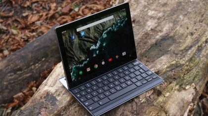
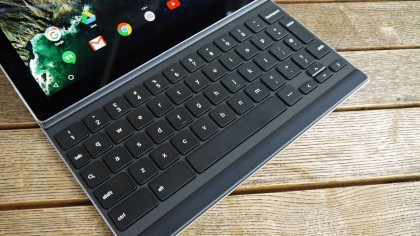
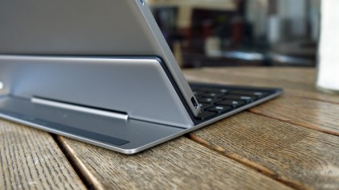
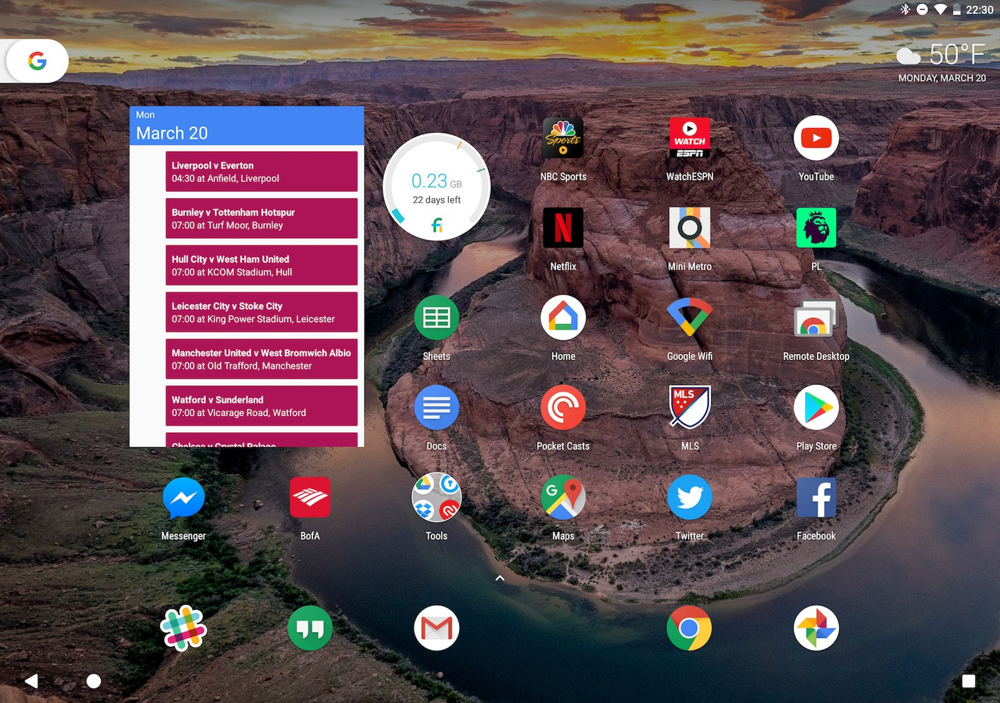
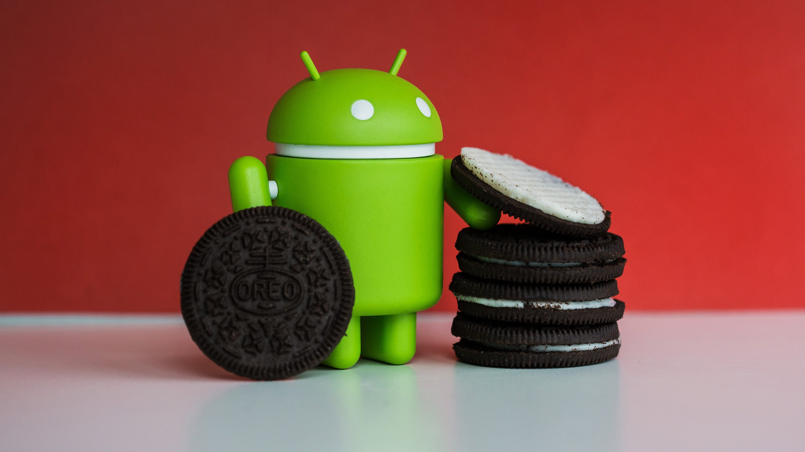

Google Pixel C & keyboard in 2017                                                                                                      by lwa.dev

 

Google’s first premium tablet design “ The Pixel C” was officially released in October 2015 and is simply the best in its class with its brilliant design quality and aluminum metal finish.

The 10.2 inch, 2560 x 1800 resolution display makes this tablet much like the Google Pixel Chromebook which was released in October 2013 and still remains to be a superior Chromebook with its gorgeous build quality, attention to detail and excellent pixel density for one of the best viewing experiences on a Chromebook, the pixel c, however, sits comfortably as a premium quality tablet.

 

This clever hybrid tablet & keyboard design is a product I have become quite fond of although it isn’t perfect I find it very enjoyable to use on a daily basis with 64gb of internal storage, a responsive keyboard which when connected with the tablet offers a self-charge facility when both are joined together, quick and speedy updates straight from Google alongside side 3gb ram for a smooth performance. I was quick to get one of these devices after its initial release, so fast forward to 2017 and with its latest software update which is currently android oreo 8.0 and the continued efforts of team pixel are evident with its fluid features and clean UX design.

With its impressive 10.2” display, dual stereo speakers embedded in the aluminum smooth edges, 4 discrete  microphones along the top, headphone jack, volume rockers and power button all in a classy aluminum finish this is a very eye-catching device, USB-C charging and data transfer port make this device very multifunctional, especially when you can connect other devices i.e phone or a laptop perhaps or an external drive for more useful functionality. You also get 8mp rear & 2mp front camera and an impressive light bar which glows with an illuminated 4 bar color which is google’s  landmark design feature which I am very fond of as it also tells you how much battery charge you have left. So with a resolution of 2560x1800 which makes for a crystal clear display, 308 PPI and a screen quality of approximately 500 nits for comfortable outside viewing it definitely ticks all the boxes.   

       

The docking system has an excellent build quality which has a heavy duty metal clasp to prevent the keyboard or tablet from easily coming apart, it also acts as a multi-angle hinge which gives a better viewing angle for media consumption and the like. The keyboard travel is 1.4mm, this may not suit everybody but as I type this review I find not issues which present a problem if I had anything to say it would be to make the keyboard backlit as this would add to the quality package design which is already very good by all accounts.

Battery life on the Google pixel c is excellent due to the continuing software updates and dose which improves performance across the board and Android apps being optimized for better handling. Google now support is good and continuing to improve, wifi 802.11 a/b/g/n/ac 2x2 MIMO support but no 4G at present.

The pixel c is a 64bit quad-core beast which is powered by NVIDIA Tegra x1 processor with 3bg ram, with a multi-core score of 4449 which outperforms nexus 9. Gaming on the pixel c is impressive and the overall experience with its quick load times adds to its appeal although some games are not yet optimised for the resolution the pixel c provides but developer updates should solve any omitting issues in the future.

The Pixel C is a great hybrid tablet from Google and has a lot to offer those who love the true stock Android experience and buttery smooth performance with a constant supply of software security patches and regular os updates. Android has a few pitfalls but in time things can only be improved and optimised as Google continues to set new standards.

I have always been an android/google fan due to customisation features android provides and together with the Google Chromebook support and chrome os I see a bright future ahead for Android purists and forward thinkers alike. My experience with this device has been excellent from a consumer standpoint and as far as a developer there is much to like and look forward too. As I write this review on the pixel c google has released the pixel 2 & pixel 2 XL mobile handsets alongside their latest Chromebook pixel 3 which only goes to prove my point with future development. I look forward to 2018 and the inception of further updates for my pixel c, I still have a 1st gen google pixel Chromebook with its excellent display and other premium features, chrome os is getting much better support and is gaining popularity and isn’t so much an afterthought as developers and the chrome community continue to make things better.

by lwa.dev

