<figure>

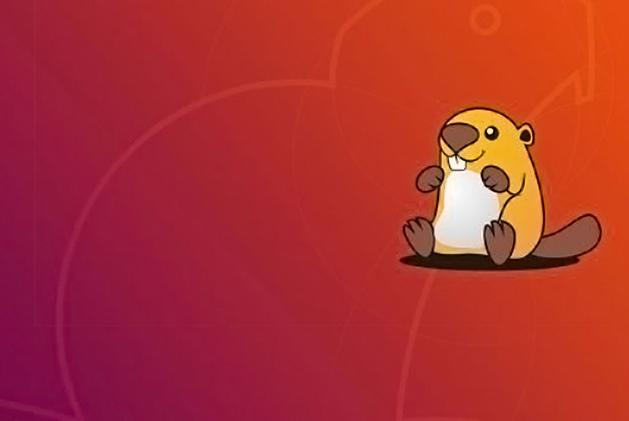

<figcaption>

**Ubuntu 18.04 LTS**

</figcaption>

</figure>

**The** Ubuntu 18.04 release is the latest long-term support (LTS) of Ubuntu, the world’s most **popular** desktop **Linux** distro.

Ubuntu 18.04 LTS comes with **5 years of support** **and** **updates** from [Canonical](https://canonical.com/), from 2018 through to 2023.

That’s huge as it means you won’t have to upgrade until the next decade!

And among the slew of new Ubuntu 18.04 features you’ll find the [GNOME Shell](https://wiki.gnome.org/Projects/GnomeShell) desktop, a crop of freshly updated software, and a promising preview of next-gen open source technology [Wayland](https://en.wikipedia.org/wiki/Wayland_\(display_server_protocol\)).

A lot has changed in Ubuntu land since the release of [Ubuntu 16.04](https://www.omgubuntu.co.uk/2016/04/ubuntu-16-04-download-new-features) back in 2016, so read on for a comprehensive look of everything that’s new in Ubuntu 18.04 LTS.

**The** Ubuntu 18.04 release is the latest long-term support (LTS) of Ubuntu, the world’s most **popular** desktop **Linux** distro.

Ubuntu 18.04 LTS comes with **5 years of support** **and** **updates** from [Canonical](https://canonical.com/), from 2018 through to 2023.

That’s huge as it means you won’t have to upgrade until the next decade!

And among the slew of new Ubuntu 18.04 features you’ll find the [GNOME Shell](https://wiki.gnome.org/Projects/GnomeShell) desktop, a crop of freshly updated software, and a promising preview of next-gen open source technology [Wayland](https://en.wikipedia.org/wiki/Wayland_\(display_server_protocol\)).

A lot has changed in Ubuntu land since the release of [Ubuntu 16.04](https://www.omgubuntu.co.uk/2016/04/ubuntu-16-04-download-new-features) back in 2016, so read on for a comprehensive look of everything that’s new in Ubuntu 18.04 LTS.

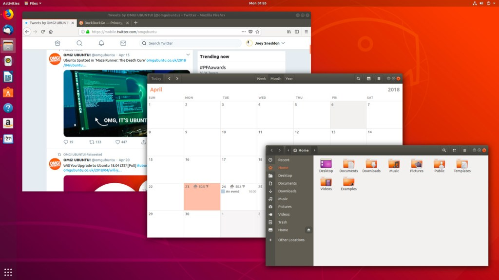

Almost every part of the OS is different, improved or new. There’s a new 

desktop, new kernel, new apps, new lock screen,new workflow, and more:

So if you’ve felt like the last couple of Ubuntu releases were lacking in the _features_ department — and you won’t be alone in feeling that —  then buckle up: Ubuntu 18.04 LTS packs more than enough bite to leave you with a long-lasting impression.

We’re talking about the most _popular,_ and arguably best-known desktop Linux distro out there, after all. Bold changes in Ubuntu have a big impact on millions of open-source enthusiasts around the world.

**How to Install Ubuntu 18.04** 

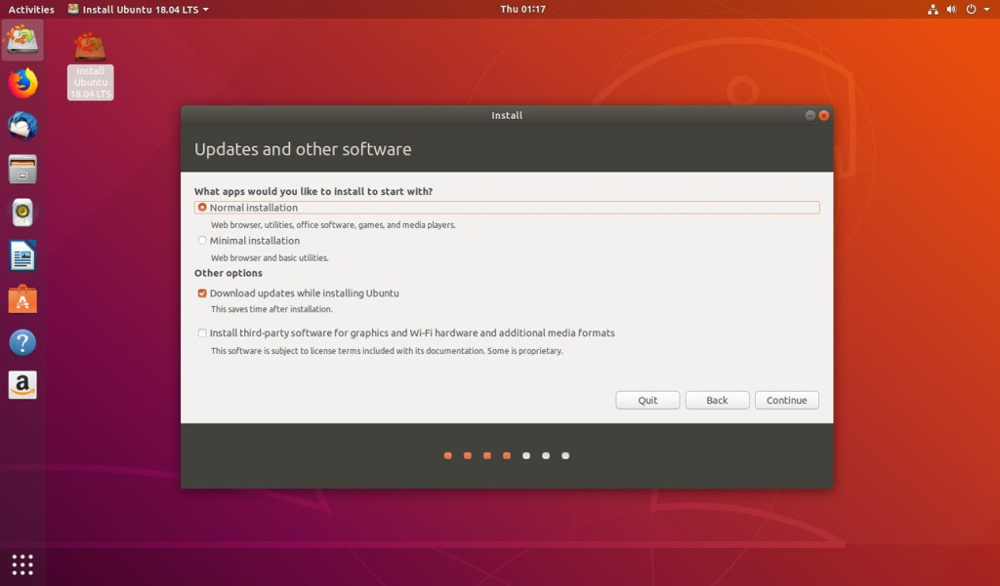

The first major changes are only noticeable when you install Ubuntu 18.04 fresh.

**Ubuntu’s new Minimal Install option gets you the core OS, but with fewer apps installed**

It’s never been particularly difficult to install Ubuntu, but in Bionic the experience has been made a bit quicker and a little simpler. Several options previously spread out across several screens are now collected together in one pane.

New options include a new **‘minimal install’**, which install the same Ubuntu OS but _without_ most of the software it typically comes with. You get a web browser, file manager and essential utilities. Everything else is gone.

[Ubuntu creates a Swapfile instead of a Swap partition during installation](https://www.omgubuntu.co.uk/2016/12/ubuntu-17-04-drops-swaps-swap-partitions-swap-files). This change won’t affect existing installs, and applies on systems where it makes sense (i.e. most). The change helps improve system performance.

Ubuntu’s First Run Wizard 

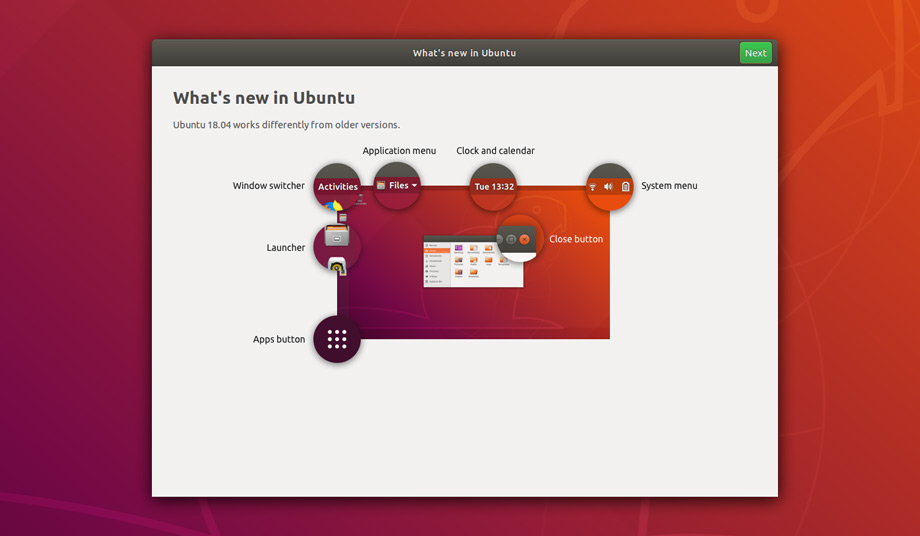

Every users of 18.04, fresh installs and upgrades alike, will be greeted by a new first run wizard called “Welcome to Ubuntu”.

This tool is not an in-depth usage companion app like _Ubuntu MATE Welcome_ but it succeeds in what it does which is: a) to bring you (and everyone else) up to speed on the new desktop, and b)  opt-in to some additional features:

- **Guide to GNOME Shell desktop**
- **Option to enable Livepatch** to [install Kernel updates without rebooting](https://www.omgubuntu.co.uk/2018/04/enable-live-patch-kernel-updates-in-ubuntu-18-04)
- **Help improve Ubuntu** by enabling anonymous system diagnostics
- **Overview of Snap apps**

**Meet the GNOME Shell Desktop** 

Of all the changes that make up 18.04 there’s only one that most people will care about: the **new desktop environment.**

**The Unity desktop used in earlier versions is replaced by the GNOME Shell desktop**

Gone is the home-grown [Unity desktop](https://en.wikipedia.org/wiki/Unity_\(user_interface\)) which helped Ubuntu cement its popularity and shape its personality since 2010. In its place is the GNOME Shell desktop.

Following a well-received dry run in [Ubuntu 17.10](https://www.omgubuntu.co.uk/2017/10/ubuntu-17-10-release-features), the desktop change is now firmly set — _Canonical CEO Mark Shuttleworth explained_ [_why Ubuntu dropped Unity_](https://www.omgubuntu.co.uk/2017/10/why-did-ubuntu-drop-unity-mark-shuttleworth-explains) _last year if you’re curious_ — and for millions of users the Ubuntu 18.04 release will be their first taste of the modern GNOME desktop experience.

Admittedly this means if you tend to upgrade to a new Ubuntu release every 6 months then this “big change” is more of a big yawn.

But if you stick with the LTS releases then the switch to GNOME Shell will take a bit of getting used to.

Hitherto ardent Unity enthusiasts needn’t panic: Ubuntu devs have made a number of tweaks to GNOME Shell to accommodate users moving up from the last LTS release and the Unity desktop:

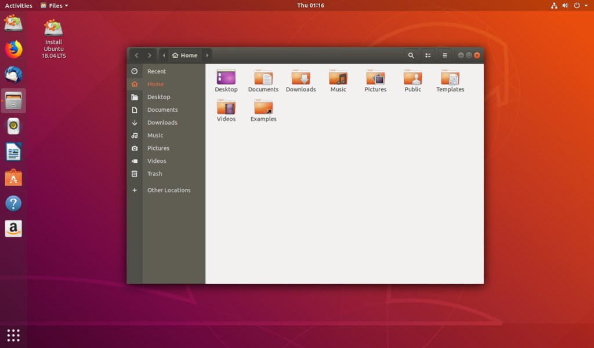

Ubuntu’s customisations include a **desktop dock** on the left-hand side (that looks and works much like the Unity launcher of old) and **support for application indicators** in the system tray of the upper right, as in Unity. 

Some well-loved features don’t make the leap.

The keyboard-friendly HUD (heads-up display) and global menus are gone; and out of the box you can’t search for files from the ‘Dash’ equivalent. Managing workspaces is now achieved using a separate screen (‘Activities’) which also offers an exposé-esque overview of all open windows.

You’ll also notice that window controls are now back on the right-hand side, and many keyboard shortcuts have changed.

- **GNOME Shell 3.28 desktop**
- **Similar layout to Unity**
- **Combined calendar & message tray**
- **No HUD or global menus**
- **Window controls on the right-hand side**

**Better Notifications**

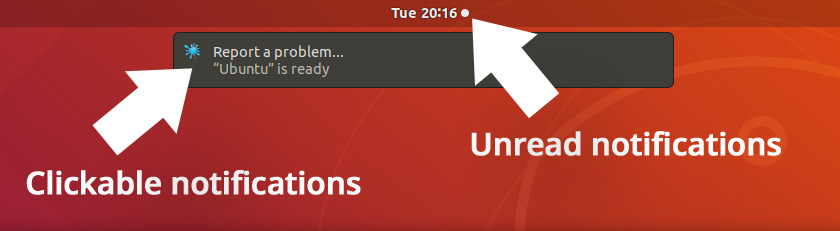

It’s not just the overlay layout that’s changes with the desktop switch. Ubuntu 18.04 handles desktop notifications differently to Ubuntu 16.04 LTS.

Those passive, transient and semi-translucent notification bubbles that cuddled the upper-right of your screen are no-more. **Notifications now show in the upper-center of the screen.** 

More features are included too. You can now dismiss alerts, “click” on them to an app, and some notifications will offer “action” buttons like handy in-line reply.

You also won’t miss notifications when away from your desktop. All unactioned notifications are now stored in the _Calendar & Message Tray_ so that you don’t miss them.

**New login & lock screen**

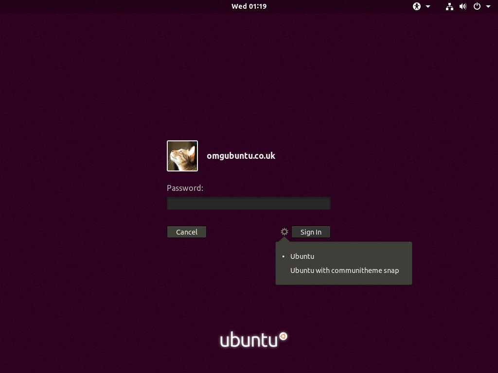

The GNOME Display Manager (GDM3) takes over login and lock screen duties from LightDM and the Unity Greeter.On the whole the login screen is more or less the same, though neither remote login or guest login features are supported, and the login screen no longer displays a ‘personalised’ wallpaper for each account.

To switch between different desktop sessions you have installed (like the optional _Wayland_ tech preview) just click the cog on the login screen, select the session, and login. Sessions are retained between logins, so once you’re done testing one do remember to switch back to the other.

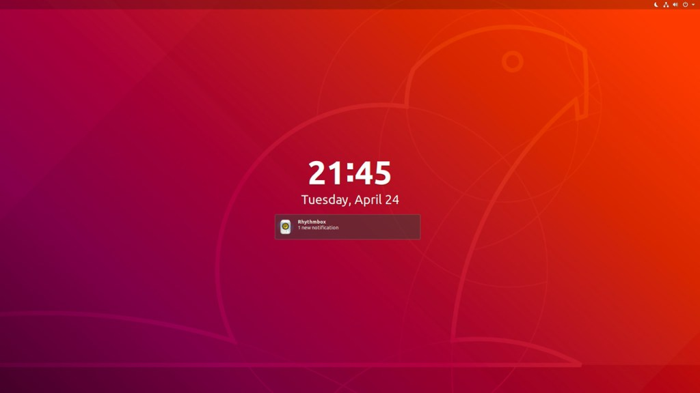

The new lock screen (pictured above) is an improvement. You can set a custom background wallpaper, and control whi notifications (if any) are shown while you’re away.

**Improved Settings App** 

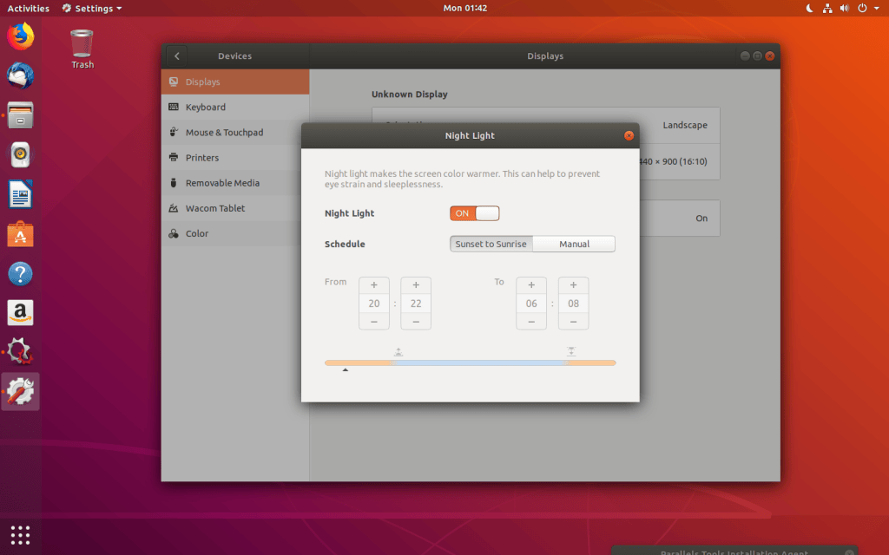

The System Settings app used in Ubuntu has changed from Unity Control Centre to GNOME Settings. It has a wider, cleaner and more organised design which is navigated from a sidebar.

You can also search for options in _Settings_ by name form inside the app or, rather helpfully, the applications screen.

**Sample a more vanilla GNOME Shell**

If you want to try vanilla GNOME Shell you can install it from the archives by running this command:

> **sudo apt install vanilla-gnome-desktop**

Restart your computer and select the “GNOME” session from cog menu at the login screen.

**You can still install the Unity desktop**

If you plan to upgrade Ubuntu 16.04 to 18.04 you won’t _lose_ the Unity desktop. It’ll remain installed to select as an alternate session from the login screen.

Similarly, for upgraders, the Unity desktop is still available to install on Ubuntu 18.04 from the archives. It doesn’t work 100% like it used to, mainly as a result of core apps using client-side decoration instead of menu bars, but the overall experience, HUD included, is in tact.

Just don’t expect any ongoing support (i.e. updates or critical fixes) for Unity from Canonical.

**GNOME 3.28**

As well as the shell 18.04 is based on [GNOME 3.28](https://www.omgubuntu.co.uk/2018/03/top-gnome-3-28-features) – a big overhaul from [GNOME 3.18](https://www.omgubuntu.co.uk/2015/09/gnome-3-18-release-new-features) which was available in the 16.04 archives.

You get access to a heap of neat features, including:

- **‘Night Light’** – warms your display after sunset to promote natural sleep patterns
- **New on-screen keyboard** – an OSK that looks and works better than Onboard
- **Thunderbolt 3 support** – you can connect and authorise Thunderbolt 3 devices
- **Media player controls in the message tray** – supports Rhythmbox, Spotify, etc
- **Wacom Graphics Improvements** – it’s now easier to use input devices with GNOME

**Easy Emoji Entry**

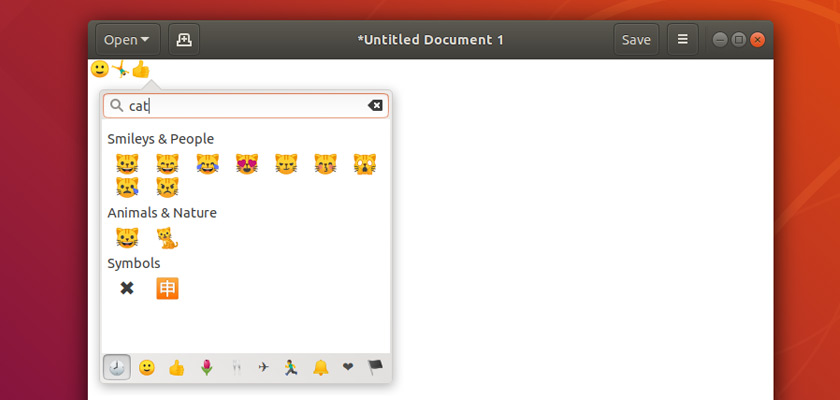

Love ’em or loathe ’em emoji are a part of modern online communication. Entering emoji on Ubuntu is easy thanks to a new color emoji picker.

To enter emoji on Ubuntu you simply need to right-click in a text field and select the ‘insert emoji’ menu item. This will open the searchable, browsable emoji picker palette.

**Laptop users**

The way you right-click has been tweaked on touchpads that lack a physical button. You now perform a **two-finger click** (tap anywhere on the touchpad with two fingers).

If you don’t like this change you can revert to the old behaviour via the Tweaks app.

Talking of touchpads and mice you can **opt to use the synaptics driver** via the Settings app if the default libinput driver causes issues.

Finally, Ubuntu will **automatically suspend** after 20 minutes of inactivity when you’re using battery power.

**Key Software Updates**

Every Ubuntu 18.04 download comes preloaded with a stack of seriously useful software.

The latest releases of the Mozilla **Firefox** web-browser and **Thunderbird** e-mail client are present. Productivity hounds will appreciate the inclusion of **LibreOffice 6**, while photography fans can snap up a slate of improvements in the Shotwell photo manager.

Ubuntu 18.04 also adds a **new ‘to do’ app** called (rather unimaginatively) “To Do”:

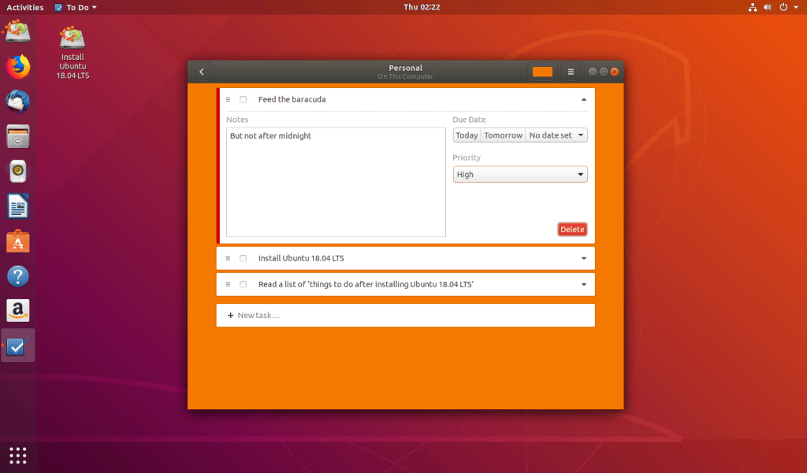

Calendar is another great core GNOME app that Ubuntu ships with. In Bionic the _Calendar_ app can now show weather forecasts for scheduled events that have a location. The app also improves the “month” view layout.

App versions in summary:

- **Firefox 59.0.2**
- **Thunderbird 52**
- **Nautilus (aka ‘Files’) 3.26**
- **LibreOffice 6.0.3**
- **Totem (aka ‘Videos’) 3.28**
- **Rhythmbox 3.4.2**
- **Remmina 1.2.0**
- [**Shotwell 0.28**](https://www.omgubuntu.co.uk/2018/03/shotwell-0-28-release)

**New Software in a Snap**

Ubuntu Software is home to thousands of free apps. You’re not stuck using what Ubuntu ships with.

Thanks to the inclusion of the _Snap Store_ the Bionic Beaver also offers a solid foundation for timely future app updates to key software.

The Ubuntu ‘Snapcraft store’ boasts a variety of big-name software already, including productivity powerhouse _LibreOffice_, browsing staple _Firefox_, as well as _Chromium_, _Skype_ and _Spotify_.

The Ubuntu Software app allows easy switching between different **channels** for Snap apps.

A handful of utilities, the desktop calculator and system monitor tools among them, are preinstalled as Snap apps. This shouldn’t have too much impact (and should allow them to be updated independently of the main OS) but they won’t “integrate” with third-party GTK themes.

**Linux Kernel 4.15**

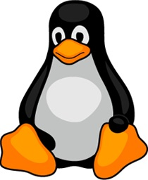

Beating away at the heart of Ubuntu 18.04 is Linux kernel 4.15.

As you’d expect this brings a raft of new and improved hardware support to the Bionic Beaver. This helps the **latest peripherals, keyboards, graphics cards and USB devices** work “out of the box”, and improves the handling and performance of other devices.

The Linux 4.15 based Ubuntu Linux kernel also features **secure memory encryption support** on AMD hardware, **improved power management** for systems with SATA Link Power Management, Linux security module stacking support — and a whole heap more.

**Ubuntu 18.04 System requirements**

Ubuntu 18.04 LTS supports most modern hardware thanks to the inclusion of the Linux Kernel 4.15. If your machine currently runs Ubuntu 16.04 LTS there’s a good chance it’ll run Ubuntu 18.04 LTS too.

The minimum system requirements:

- **2GHz dual core processor** (or better)
- **2GB RAM**
- **25GB of free hard drive space**
- **DVD drive or USB port for install**
- **Internet access**

The more RAM you have the happier Ubuntu will be; the new GNOME Shell desktop isn’t quite as nimble as. Don’t forget that many Ubuntu flavours are also available with lower system requirements, such as Kubuntu 18.04 LTS and Ubuntu MATE 18.04 LTS.

Ubuntu and its flavours include **UEFI secure boot support**. This means (in theory) you can boot and install Ubuntu alongside Windows 10 without having to enable legacy BIOS features.

**Ubuntu 18.04 Summary**

Ubuntu 18.04 LTS is a polished, performant update.

The GNOME Shell desktop lends a modern appeal, Snaps help serve up swift software updates as and when they’re available, and while the overall performance could be better, most modern laptops and PCs won’t break a sweat running Ubuntu.

In short, **we highly recommend this release**.

**Ubuntu 18.04 features in a nutshell:**

- New GNOME Shell desktop
- ‘Minimal’ install option
- Linux Kernel 4.15
- Access to Snap apps
- Support for color emoji
- Support for Thunderbolt 3
- Updated apps, inc. LibreOffice 6.1
- Set of Snap apps by default
- New ‘To-Do’ app
- Python 3.6
- New installs use Swap files by default
- Optional Wayland session

by lwalinux 25.10.2019

