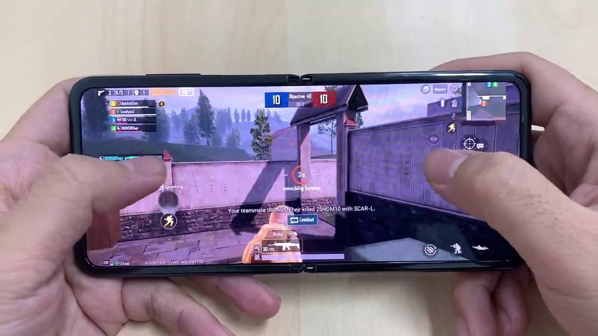

### SAMSUNG GALAXY Z FLIP SPECS

**Price:** 1,399  
**Screen (open):** 6.7-inch Super AMOLED (2636 x 1080)  
**Exterior screen:** 1.1-inch Super AMOLED (300 x 112)  
**CPU:** Snapdragon 855 Plus  
**RAM:** 8GB  
**Storage:** 256GB  
**Cameras:** 2 12MP (main: f/1.8; ultra wide: f/2.2) rear/10MP (f/2.0) front  
**Battery:** 3,300 mAh  
**Size (open):** 6.6 x 2.9 x 0.28 inches  
**Size (folded):** 3.4 x 2.9 x 0.61-0.68 inches  
**Weight:** 6.5 ounces

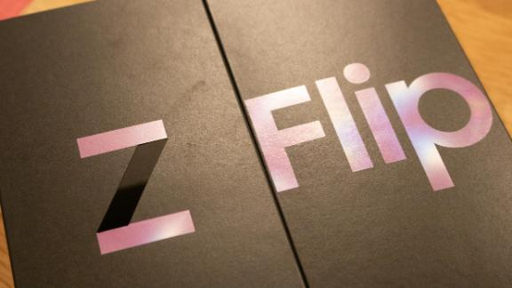

### My initial first thoughts.....

When i first held the **Galaxy Z Flip** in my hand, i was immediately impressed by the actual fold-able size and impressive build quality from Samsung, i imagined this device to be a fold-able **Galaxy s10e** but with a more unique and translucent color **(purple)** and obvious flexible display. Not to mention the hinge aka **(Flex Mode)**, which now being able to hold itself in various positions unlike its bigger brother variant the **Samsung Galaxy Fold** of which is a first of its kind, as is the **Galaxy Z Flip**, with both having cutting edge displays, flexible hinge, and bold innovating designs. Turning on the **Galaxy Z Flip** led me to the infamous android **"Start up Screen"**, of which the setup process is seamless and a joy of relief to use, very clear instructions and guides on screen and if setting up from a previous android or Samsung device then the overall process is intuitive and very easy to follow along, as with **iOS** sometimes the process of setting up devices is not always as straight forward but **Samsung and Google** deserve credit here as I never run into issues and i constantly setup and test or review devices so.. 10/10 in that regard. Once all that has been done there are some guide lines on screen which should be taken into account if you have never used either the **Samsung Galaxy Fold** or the **Galaxy Z Flip** .

### MY VERDICT

The **Galaxy Z Flip** is the best fold-able phone so far in 2019, topping the Motorola Razr in build quality, design and display. But at a steep price, it maybe difficult to recommend this phone over more traditional flagships like Galaxy S10 Plus/ Note 10 Plus/ S20 Plus.

#### **FOR**

- Snapdragon 855 Plus is plenty powerful

- Ultra-thin glass aids durability

- Compact design when folded

- Competitive Price against Galaxy Fold

- Unique Design

- Supports 12watt fastcharge + reverse charge

- Multiple Colours: Mirror Black, Purple, Gold

#### **AGAINST**

- Subpar battery life 3,300 mAh

- Mono Single Speaker Output

- Small Outer display

- No Included Wireless Earbuds

### Design

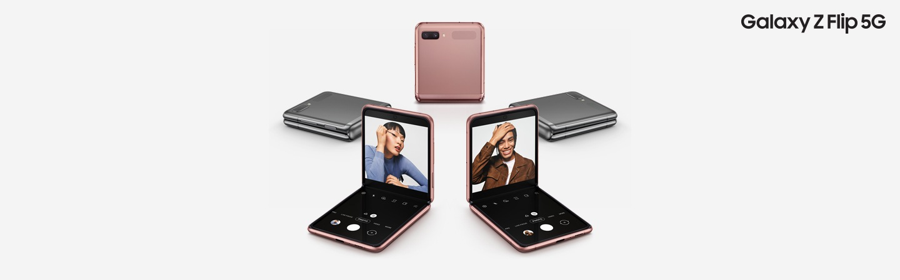

I remember the original **Samsung C3590** with its 2.4" tft screen, smart flip phone design, great battery life however, the original **Motorola Razr** flip phone holds its own iconic pass to many mobile phone tech savvy enthusiasts but, the **Galaxy Z Flip** is different.

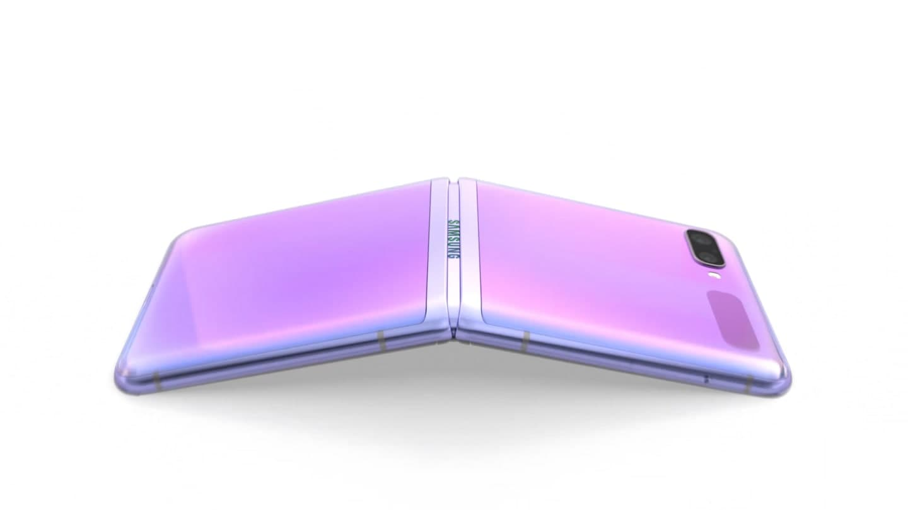

This time around, the **Galaxy Z Flip** flips open vertically to reveal a **6.7-inch (2636 x 1080) Amoled-display** that includes a layer of **ultra-thin glass** for an extra level of durability. The flexible glass display does feel more like plastic but not by any means does it feel cheap, it is the same build quality as the original **Samsung Galaxy Fold** but with more protection added this time round.

The display quality is truly incredible, smooth scrolling, responsive yet fluid screen gestures and coming from devices which i have seen from Samsung they have done an amazing job. The **Z Flip's** **hideaway hinge** is designed to **keep out dust**. It's got a thin layer of fabric to make sure particles can't find their way into the gap that exists between screen and hinge.

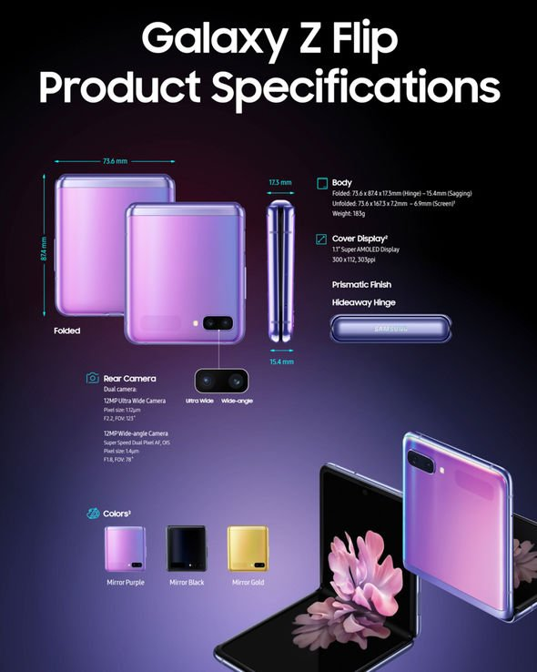

### Display Qualities

Samsung has turned to a **full-HD+** display for the **Galaxy Z Flip**, with a resolution of **2636 x 1080 pixels**. That's a lower resolution than the **quad-HD+** panels inside the **Galaxy S20** series, but it's certainly sharper than the **Razr's 6.2-inch**, HD+ screen. Now Samsung has definitely made great improvements to the visual display area on this device but, for some the fact that a crease can still be seen between the joining of the top & bottom displays may not be to everyone's liking... I myself didn't find this a problem while viewing content, watching **YouTube, Netflix**, or playing any **games**....

Samsung has managed to fit a pretty colorful display into the **Galaxy Z Flip’s** folding frame. In its default Vivid setting, the screen captured **200.8%** of the sRGB color spectrum, which means bright, if saturated, colors. Switch the viewing mode to Natural, and you’ll see **122.1%** of the sRGB color spectrum on the **Galaxy Z Flip**, comparable to what we found when testing against the Galaxy Fold’s Natural mode **(124.8%.)**.

Those colors could be more accurate. The Samsung **Galaxy Z Flip** has a Delta-E rating of **0.31** in **Vivid** mode compared to the S20 Plus’ 0.36 rating You’ll get more accurate colors when switching over to **Natural** mode on the **Z Flip**, where the color accuracy rating improves to **0.21.**

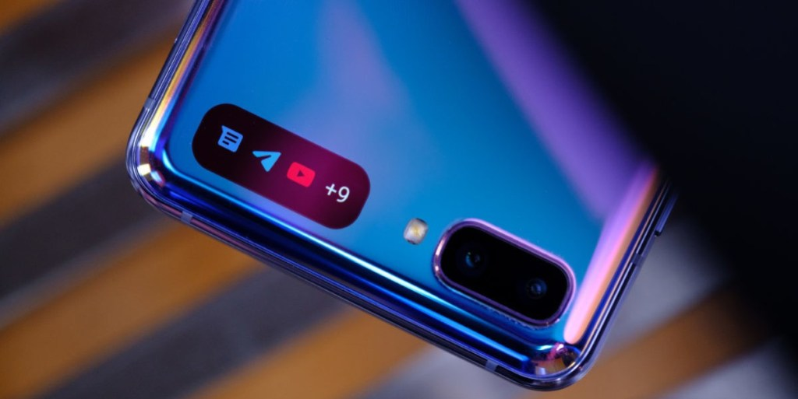

On the **Galaxy Z Flip** exterior, you'll find a **1.1-inch Super AMOLED** panel that's just big enough to notify you of incoming calls, texts and alarms. It can also display the date and time, so you're not trying to open the phone just to see what time it is. The exterior panel serves **several functions**: You can use it as a mini-view finder to shoot selfies with the Z Flip closed. Just **press the power button** **twice** to summon up the viewfinder and then hit one of the volume buttons to snap the shot. You only see a sliver of your face, but it's still an ingenious way to save you from opening up the phone just for a **self-portrait**.

## Galaxy Z Flip: Day to Day Use

Once you start to use the **Galaxy Z Flip** it quickly becomes apparent that when all the rumours are said and done, the **build quality**, and **craftsmen-ship** of the device comes into play.... it really is well build and is not as **flimsy** as you may first think. The **outer case** feels very **substantial** and opening the Z Flip does takes some effort, So Forget about whipping the **Galaxy Z Flip** out of your pocket and snapping it open with a flick of your wrist like the flip phones of old, better safe than sorry i thought while its still new to me...

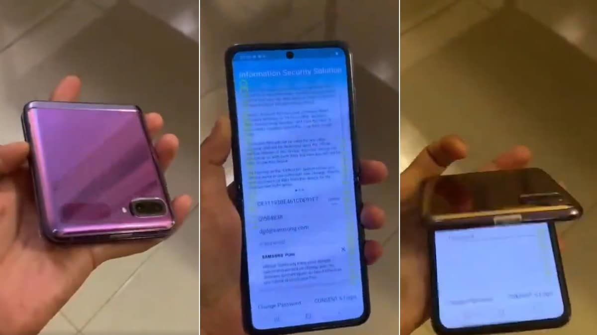

There is no noticeable sounds or creaks from the hinge when you open or close the **Z Flip**, you can stop adjusting the angle of the **flexible display** wherever you wish, **Samsung** has dubbed this Flex mode, and when you enable it by opening the **Z Flip** into an **L-shape**, the top half of the **Samsung Galaxy Z Flip's screen** serves as a **viewing area** while all your actions are on the bottom of the screen. Use the camera app in **Flex mode**, for example, and the top of the screen becomes a **viewfinder** while the bottom houses the shutter button and menu options. 

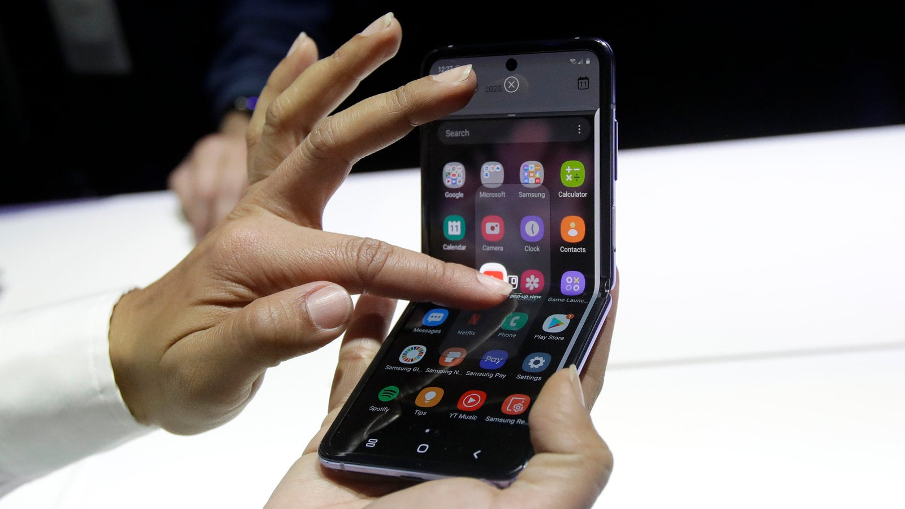

YouTube, which Google updated specifically for the Z Flip, displays the video in the upper portion of the screen, letting you scroll through comments and related content on the bottom. It’s a very clever use of the Z Flip’s unique design, but it would be even better if more apps took advantage of Flex mode.

## Battery Life & Charging

Inside the Samsung Galaxy Z Flip is a **3,300-mAh battery**, a respectable size for a Fold-able smart phone, if this was a larger capacity this would have given many other manufactures a run for there money......

**Pixel 4**: 2,800 mAh

**Pixel 3a**: 3,000 mAh

**Pixel 4a**: 3,140 mAh

**Galaxy S10e**: 3,300 mAh

**Motorola Razr**: 2,510 mAh

On average the **Galaxy Z Flip** lasts for approximately **8 hours**, so it's not a typical **all day battery life** performer but, it does have some other features which do improve on situations where a **"Quick Charge"** may be necessary... Like other recent Samsung flagships, the **Galaxy Z Flip** supports **Wireless PowerShare**, meaning you'll be able to **wirelessly** charge other Qi-compatible devices with this phone. 

## Performance & Software

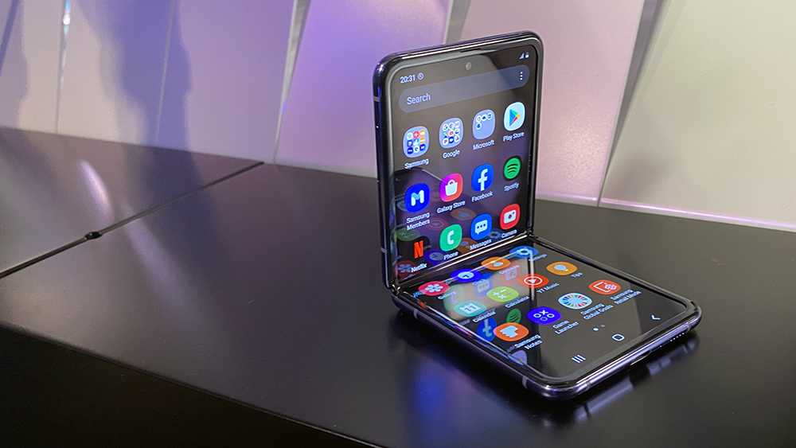

Thanks to **Android 10** and its support for fold-able devices, the Samsung **Galaxy Z Flip** offers multitasking through a **Multi-Active Window feature**. You'll be able to select the apps you want to use on different parts of the screen, though that feature only works with select apps. **Multitasking** on the **Galaxy Z Flip** is simply a matter of swiping right from the side of the screen to bring up a tray of apps that support the feature. Some apps work better than others with the **Multi-Active Window feature**. The feature works whether you’re holding your phone in **portrait** or **landscape** mode.

**Samsung One UI 2.5** and its software customizations for **Android 10** and the **galaxy Z Flip, galaxy Fold, S9 & S10 series** of devices...This includes Samsung Dex support, Wireless connectivity, expanded menu features and tweaks for usability, Camera and Video recording and other new improvements, [click here](https://androidarcitect.com/2020/09/18/one-ui-2-5-android-10-final-update/) to find out more....

### My Final Thoughts....

So my time with the **Galaxy Z Flip** has been a memorable one. Before it arrived i had many thoughts on typical use and how i would feel about it as my daily driver. When i first saw the **Galaxy Fold 5G** i was some what excited at the technical aspect of what **Samsung** had designed, after watching the **Samsung Unpacked** and countless videos i quickly came to appreciate and realize that holding the device or owning such devices is a completely different experience as you learn more about what you want to do and what you can achieve while multi-tasking fashion.

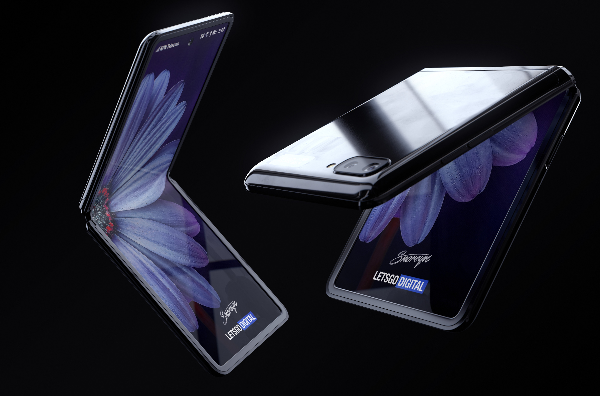

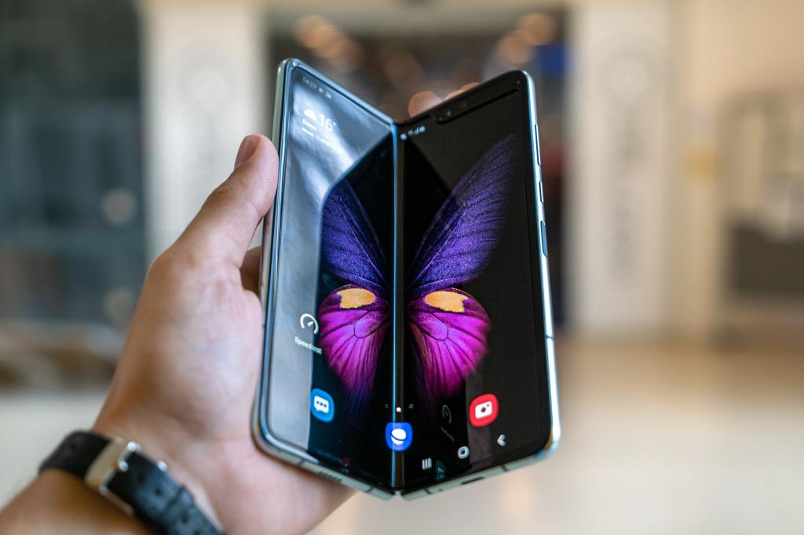

The ability to view content in many different ways is truly remarkable. **Samsung** has made bold steps in technology and although not perfect, i would like to think that through further software updates and **Samsung's** own **One UI 3.0** with **Android 11**, the user's expectation, experience and reliability is something we now have all come to expect and rely on. The cost of devices and flagship technology my seem a high price to pay but, what you are getting is the best of the best and, if you are as passionate about software and hardware as any **developer**, **software engineer** or **tech enthusiast** then, through caution to the wind, and enjoy the best of technology now and what is yet to come in 2021....

**Written by** Android Arcitect

Special thanks to **"MobileTechSurgeons"** for brilliant customer service on tech related products [click here](https://www.ebay.co.uk/usr/mobiletechsurgeons?_trksid=p2047675.l2559) for more details...

