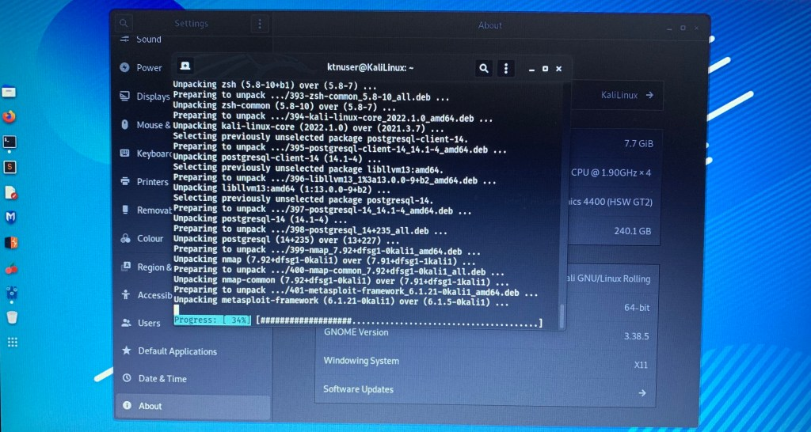
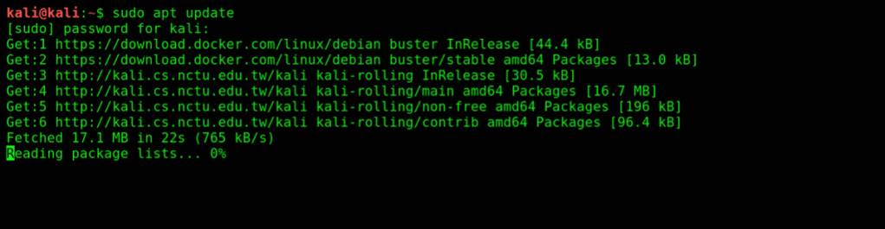
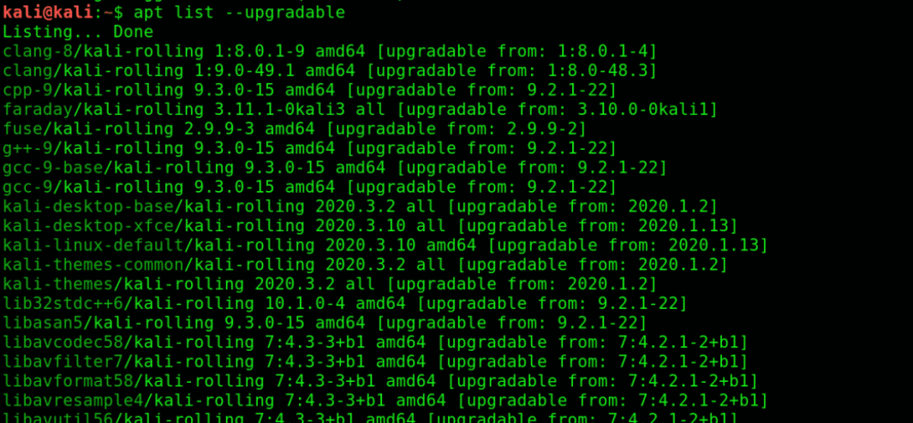
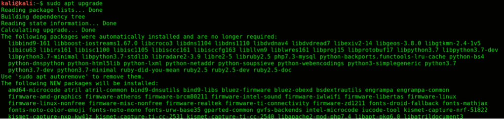
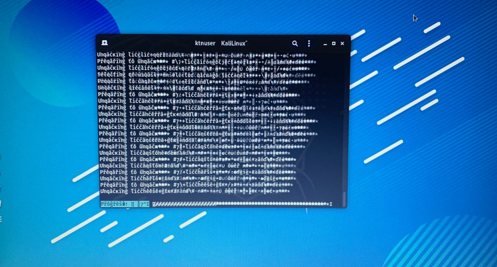
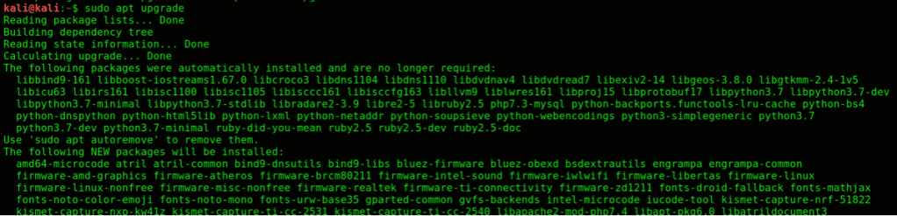
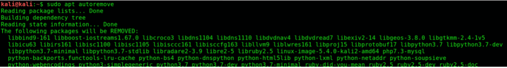
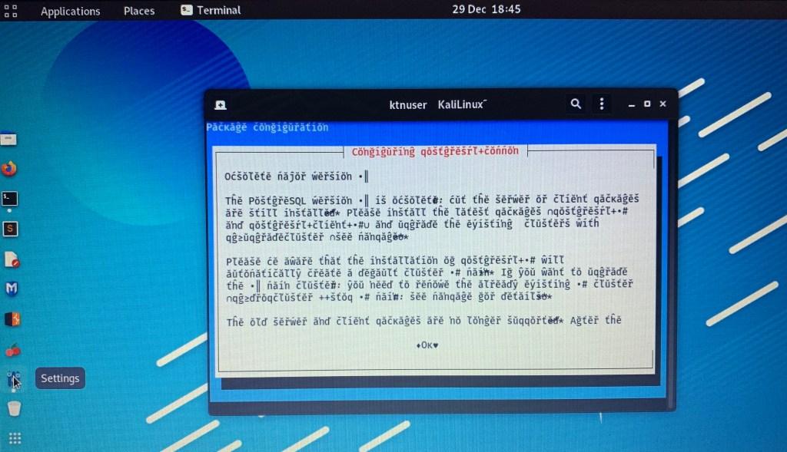
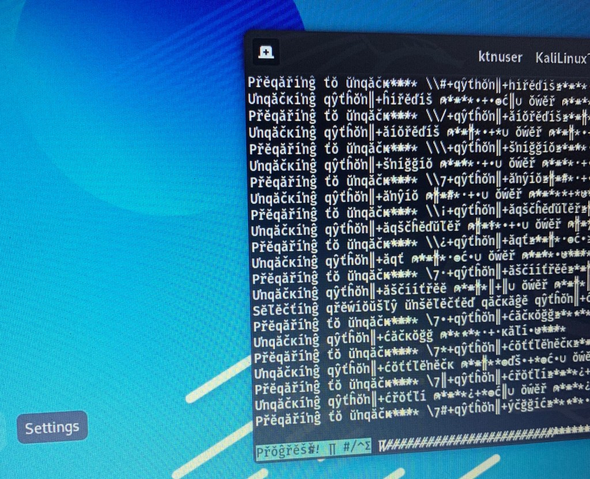

## Rollin' Release anyone..?

**The Kali OS** includes over 600 tools in total, is completely free, and has an open-source Git tree publically available. Kali Linux is so well-known among cybersecurity professionals that its name has practically become synonymous with pen-testing.

**Kali-Linux** was released in 2013 as essentially a complete rebranding of "**BackTrack Linux**" with a GNOME interface. The developers trimmed all the fat off of **BackTrack** by removing its subpar utilities and updating the ones that were acclaimed in the "**white-hat**" community.

**Kali-Linux** is a Debian-based Linux distribution that comes with many unique and streamlined utilities aimed at making pen-testing more accurate, quick, and easy.

On the surface, Kali is just like any other OS: it plays audio and text files, supports every software that Windows and macOS supports, and you can even. access the internet with it.

Unlike the other operating systems, Kali has a large set of tried and tested pre-installed applications, making it more than a simple OS.

## **Updating Kali Linux**

The following sections will show you a step-by-step process for updating your Kali Linux system.

**1\. Configure Kali Linux Repositories**

First, look for the **Kali repositories**, as you must first adjust them before updating them. Double-check that your sources.list file at/etc/apt/sources.list has all the relevant Kali repositories, which include the following:

\***https://http.kali.org/kali kali-rolling main non-free contrib**

\***deb-sources https://http.kali.org/kali kali-rolling main non-free contrib**

Be sure to use only the **official Kali repositories**, as using external unofficial repositories can jeopardize the system security of the host. Using repositories other than those that have been officially released by the Kali team can harm your system.

**2\. Start Update**

You will first need to update the package indices list before you can update the Kali Linux system. To do so, enter the following syntax into the command terminal:

**$ sudo apt update**

Then, check for the updates that have been released by entering the following command:

**$ apt list --upgradable**

Enter the following command to individually update each package:

**$ apt install PACKAGE-NAME**

Or, enter the command below to update all packages simultaneously:

**$ sudo apt upgrade**

Wait for the updates to download and install completely. This will take some time; how much time depends upon your system specs.

The updates have finished installing, but we are not done just yet!

**3\. Update Held-Back Packages**

It could be that you have not actually updated all the packages, as not all of them are listed. This issue is likely due to package dependency issues or could have some other issue associated with it.

Nevertheless, you can check whether there are any shortcomings in the updates you have downloaded by entering the following command in the terminal:

**$ sudo apt upgrade**

The procedure to download the held-back packages is the same as that used for downloading the listed packages. Enter the following command to individually download each package:

**$ sudo apt install PACKAGE-NAME**

Or, you can enter the command below to download all of the packages at once:

**$ sudo apt dist-upgrade**

**4\. Uninstall Obsolete Packages**

To remove any outdated packages on your system, use the following command:

**$ sudo apt autoremove**

Remember, to optimally upgrade your Kali system, all you need to do is just configure the repositories and install updates with the “**$ sudo apt upgrade command.**” It is as simple as that.

Monitor and keep watch when you are using third-party repositories. This could potentially break your Kali Linux Rollin Release system, in which case you would have to install Kali all over again. Also, be sure to free up some HDD space by deleting any outdated packages.

**$ sudo apt autoremove**

<figure>

<figcaption>

lwalinux

</figcaption>

</figure>

