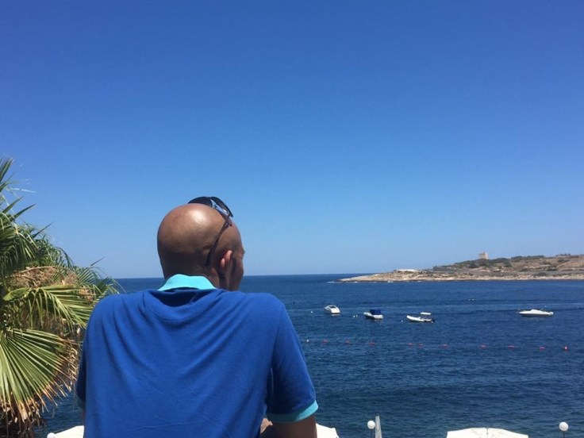
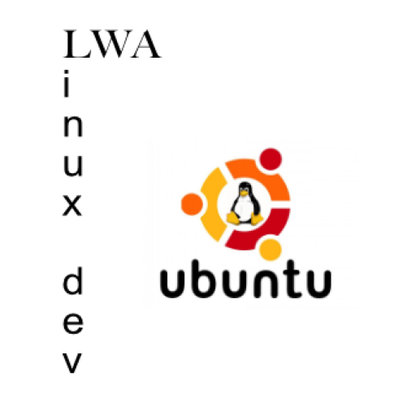
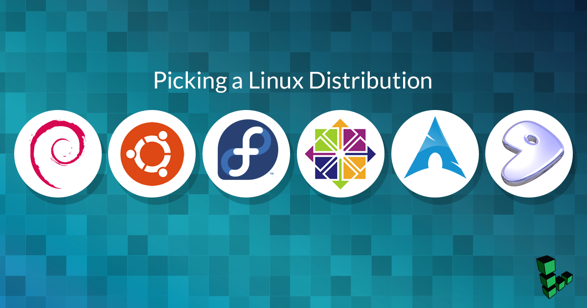
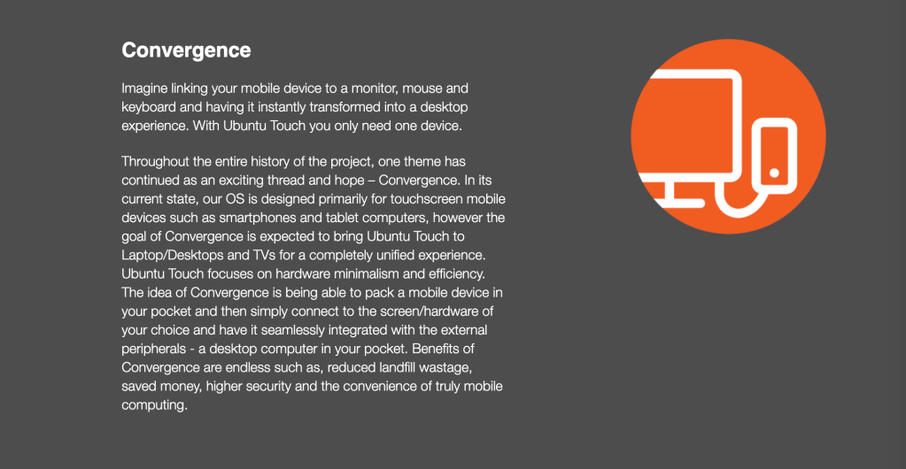
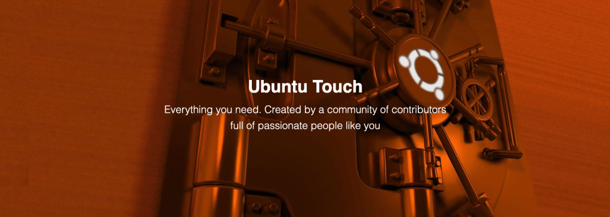
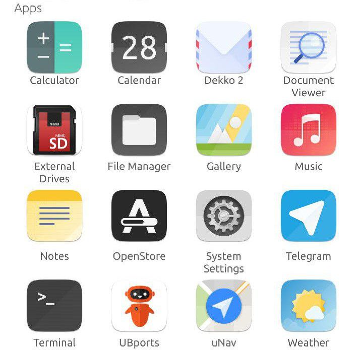
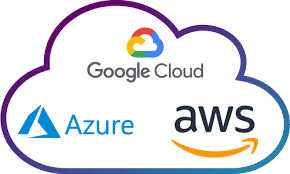

## **LWA-Linux Dev**

Hi I’m **lwalinux**, and I am a Linux User and open-source advocate currently utilising free software-based Linux distribution architecture from **Arch Linux, Debian, Fedora, CentOS, Manjaro & Ubuntu** since mid 2015 as linux started to develop into something more for the open-source community.

**Debian** is indeed the founding forefather of **Ubuntu** Linux in that the kernel and most of its core architecture is very similar, the **Gnome desktop** and overall operation system have shared functionality but where they differ is in general setup, customisation and installation of packages where Debian is very much hands-on, and these things will need to be done manually and, will require a package manager to achieve this process.

## Debian and Ubuntu Linux…

I come from a background of early computing when in the earlier years computers & processors had not quite reached their potential, just as when the internet was born these technologies needed time to grow. I have enjoyed watching the transformation of software development and hardware technologies fast forward into what we have today, and for that same reason i have always had a passion for technology, wearable tech, computers, smart phones and the software languages which make this all possible.

**Canonical**, the company and subsequent creators behind **Ubuntu** Linux and its software releases since the late 1990’s recently started a mobile os project called “Convergence” which would bring mobile phone, tablets, laptops into a unified **ecosystem** whereby a simple device would harness the power of a fully integrated desktop OS...

And Changing the way we can use our mobile devices for the future, however this technology didn’t gain enough support and was unfortunately cancelled in April 2017…

But the project continued its support under the **open-source** continuum currently known as the “UB-Ports Community” and its pool of talented resource and open source initiatives like this, powered by the **GitHub** community of developers and software testers is what makes this unified thinking such an amazing and impressive experience to become a part of in open source awareness….

<figure>

<figcaption>

**Ubuntu-Touch.io A mobile version of the Ubuntu Operating System**

</figcaption>

</figure>

## The Ubuntu Touch Apps

**Ubuntu Touch** offers everything you need. All kinds of applications are available. Apps for communication, messaging, music, administration, navigation, tools, games and a lot more.  

**Ubuntu Touch** comes pre-installed with a set of important and solid core apps that cover your daily needs. This includes everything you expect from a phone, like a dialer, contacts and calendar, but since it’s Linux family, the OS comes with a fully-featured file browser and terminal (including essential command-line applications) as well.

I myself have been using **Microsoft, Mac Os, Chrome Os and Linux** over a number of years now however, i still treat tech with kids gloves and look forward to learning new approaches to solve problems, seeing as software has become much more advanced we are able now to create things more creatively. More developments are happening as we speak…

Software engineers & developers alike are playing important roles in our digital lives and the future is most definitely bright…

Cloud Computing eg **Azure, Amazon AWS, Google GCP are shaping how we deal with data and cloud operations, I** am familiar with the concepts but recently I have decided to play a part in this infrastructure as I feel its the next logical step and “tech never sleeps and ideas never stop!” so, I can only embrace what new dawn awaits us all on the other side of the digital realm.

by lwalinux 24.10.2019

* * *

### What People Say

> The way to get started is to quit talking and begin doing.
> 
> WALT DISNEY

> It is our choices, that show what we truly are, far more than our abilities.
> 
> J. K. ROWLING

> Don’t cry because it’s over, smile because it happened.
> 
> DR. SEUSS

* * *

## Let’s create, build & deploy something amazing together.

[Get in touch!](https://www.facebook.com/LWA.DevMedia/)

