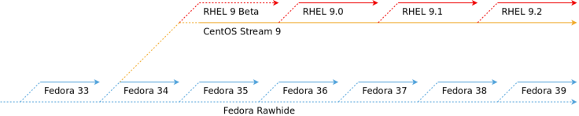
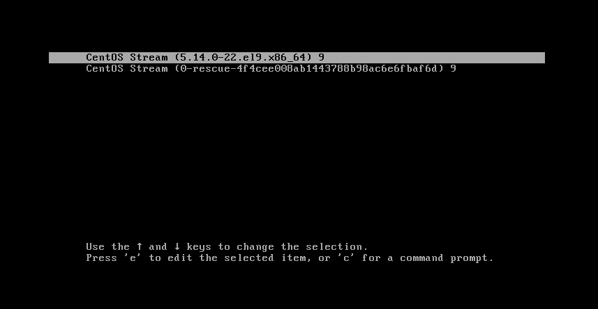

The decision by RedHat & general release date of CentOS Stream 9 has been a topic of contention for alot users prior to CentOS Linux 8 imminent expiry date at the end of this year 2021.

Now, the new CentOS project is showing off the latest and greatest in the first all-new release of CentOS Stream 9.

https://www.youtube.com/watch?v=tjBGKXchLlA

**CentOS Stream**: At the end of 2020, the [announcement](https://blog.centos.org/2020/12/future-is-centos-stream/) that Red Hat will shift its focus from **CentOS** Linux to **CentOS Stream** caused heated discussions. As you can imagine, many users were not satisfied with this decision, However now the new **CentOS** **Project** is showing off the latest and greatest in the first all-new release of **CentOS** **Stream 9**.

As part of Red Hat’s open source development model, Red Hat develops the Red Hat Enterprise Linux source code in CentOS Stream before releasing new Red Hat Enterprise Linux versions—making CentOS Stream a preview of future Red Hat Enterprise Linux releases.

For current **CentOS** Linux users who will have to migrate between 2021 and 2024, **CentOS Stream** is a migration path which allows you to participate in the development of future versions of Red Hat Enterprise Linux. For organizations that need a production-grade platform for important business applications and workloads, [Red Hat Enterprise Linux](https://www.redhat.com/en/technologies/linux-platforms/enterprise-linux) is the recommended option.

[Read the migration path information sheet](https://www.redhat.com/en/technologies/linux-platforms/enterprise-linux/centos-migration)

CentOS Stream is an important part of the larger Red Hat Enterprise Linux source code development process:

- [Fedora:](https://getfedora.org/) The upstream project on which future Red Hat Enterprise Linux major releases are based. This is where significant operating system (OS) innovations are introduced.
- **CentOS Stream**: An upstream open source development platform where you can develop, test, and contribute to a continuously delivered distribution that tracks just ahead of Red Hat Enterprise Linux.
- **Red Hat Enterprise Linux**: A production-grade operating system that provides a more secure, supported, and flexible foundation for critical workloads and applications.

https://www.youtube.com/watch?v=IEEdOogPMY8

## Why contribute to CentOS Stream?

Community contributors to **CentOS Stream** get early access to the same code Red Hat developers and engineers use to produce the next version of **Red Hat Enterprise Linux**. 

- Hardware partners and application developers can test their solutions, checking that everything works as it should with the next release of Red Hat Enterprise Linux.
- Community members can contribute new features and patches that can improve the capabilities and security of the next Red Hat Enterprise Linux release.
- Users of CentOS Stream can share feedback without having to wait for the next Red Hat Enterprise Linux release.

**CentOS Stream 9** includes upgrades that will help keep users in front of the latest technologies. Some of them are:

- [PHP](https://linuxiac.com/how-to-configure-nginx-to-work-with-php-via-php-fpm/) 8.0
- [Python](https://linuxiac.com/python-the-most-popular-programming-language/) 3.9
- MariaDB 10.5
- [Nginx](https://linuxiac.com/install-and-configure-nginx/) 1.20
- GCC 11.2

On the "**DE**" desktop environment, **CentOS Stream 9** offers support for the **GNOME 40/4**1 desktop, which comes with its own set of new features and work flows. Under the hood the distrobution is powered by the **Linux 5.14 kernel** series.

## Download

If you’re looking to give **CentOS Stream 9** a try, download an ISO from the [official download page](https://www.centos.org/download/). You can get versions for 64-bit x86, 64-bit ARM, and IBM Power architectures.

You can test drive this or any Linux distribution in a either a VM "**Virtual Machine**" or dual partition scheme alongside you current OS of choice or, you may decide as i did to in fact install via "**Bare Metal**" which is a full / complete install on a dedicated machine as a primary OS which has many benefits depending on you usage and project requirements.

by lwalinux 16/1/2022

